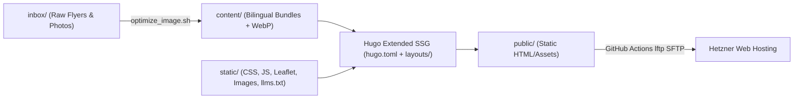

# Architecture — Palazzo Usellini

Static bilingual website (`it` at `/`, `en` at `/en/`) for **Palazzo Usellini** ([palazzousellini.com](https://palazzousellini.com)), built with Hugo Extended and deployed via SFTP to Hetzner shared hosting.

## System Overview & Data Flow



## Technical Stack & Specs

| Component | Technology / Config | Notes |
| :--- | :--- | :--- |
| **SSG** | Hugo Extended (`hugo.toml`) | `defaultContentLanguage = 'it'`, `disableKinds = ['taxonomy', 'term']`, Lanczos imaging @ 85% |
| **Languages** | `it` (`/`), `en` (`/en/`) | `hreflang` + `x-default` in `baseof.html`; client-side first-visit redirect on `/` via `localStorage` |
| **Styling** | Vanilla CSS (`static/css/style.css`) | Mobile-first, `color-scheme: light dark` + `<meta name="color-scheme">` + `[data-theme]` tokens |
| **Client JS** | Vanilla JS (`static/js/main.js`) | Deferred, zero external runtime deps: mobile drawer, `<dialog>` lightbox, daily event calendar filter, theme toggle |
| **Maps** | Self-hosted Leaflet (`static/vendor/leaflet/`) | Loaded only on `/contatti/` (`osm-map` DOM container, zero cookies) |
| **Agentic / SEO** | Schema.org JSON-LD, `/llms.txt`, `/llms-full.txt` | `LandmarksOrHistoricalBuildings` structured data in `<head>` |
| **CI/CD** | `.github/workflows/deploy.yml` | Builds `public/` and syncs via `lftp` SFTP using GitHub Secrets |

## Directory Structure

```text
palazzousellini/
├── .agents/skills/optimize-images/   # Image resize, EXIF strip & WebP conversion skill
├── .github/workflows/deploy.yml      # CI/CD build & SFTP deploy to Hetzner
├── content/                          # Bilingual Markdown bundles (index.md / index.en.md)
│   ├── _index.md, _index.en.md       # Homepage copy
│   ├── storia/, galleria/, contatti/, privacy/
│   └── news/                         # Event & concert bundles (events: YAML frontmatter)
├── docs/
│   ├── architecture.md               # System structure & data flow (this file)
│   └── historical-errors.md          # Categorized error memory & prevention patterns
├── inbox/                            # Temporary staging for incoming event materials
├── layouts/                          # Hugo HTML templates (baseof, index, news, galleria, storia, contatti)
├── scripts/                          # Utility scripts (deploy_sftp.py, migrate_publii.py)
├── static/
│   ├── css/style.css                 # Main stylesheet
│   ├── js/main.js                    # Client-side interactions
│   ├── images/                       # Hero WebP/JPG & brand logo
│   ├── vendor/leaflet/               # Self-hosted Leaflet assets
│   └── llms.txt, llms-full.txt       # Machine-readable site summaries
└── hugo.toml                         # Hugo & multilingual menu configuration
```
